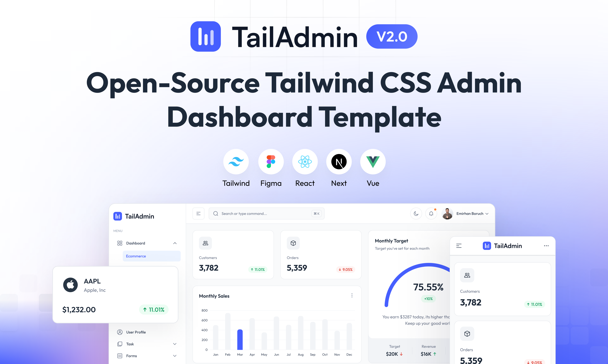

# InstaMall Web Frontend (TailAdmin + Next.js)

This web app started from the TailAdmin Next.js template and now contains the InstaMall storefront, authentication flow, shop dashboard, and admin pages. It calls the separate backend through a browser-side API adapter; backend code is not part of this package.

For a high-level map of the current folders, routes, data flow, components, and naming conventions, read [the Arabic frontend architecture guide](./docs/frontend-architecture.md).



With TailAdmin Next.js, you get access to all the necessary dashboard UI components, elements, and pages required to build a high-quality and complete dashboard or admin panel. Whether you're building a dashboard or admin panel for a complex web application or a simple website.

This starter uses **Next.js 16**, **React 19**, and **TypeScript** for the front-end experience. Although Next.js supports server-side APIs, this boilerplate intentionally keeps application data services outside the Next.js app.

## Overview

The starter UI includes reusable components, layouts, forms, charts, tables, and internationalization. It is built on:

- Next.js 16.x
- React 19
- TypeScript
- Tailwind CSS V4

## Architecture

- **Front-end only:** There are no Next.js API routes, server actions for application data, or database integrations. Connect to backend services through browser-side HTTP adapters.
- **Data flow:** Pages and components consume feature-level adapters; adapters translate external or mock data into UI-facing types. The shared HTTP client uses the platform `fetch` API.
- **UI and state:** Prefer existing Base UI primitives and small, composed components. Keep client-only behavior in the smallest component that needs it.
- **Styling:** Use Tailwind utility classes and the existing design tokens. Avoid inline styles; when a third-party component requires runtime styles, isolate that exception and prefer its class-based API where supported.
- **Routing:** Keep pages in the existing App Router route groups and preserve the locale-aware root layout. Each route segment owns `layout.tsx`, `loading.tsx`, `error.tsx`, and `not-found.tsx`; keep these thin and reuse shared boundary UI.
- **Notifications and failures:** Surface request and runtime failures through shared error formatting and the app notification UI; do not silently substitute success-shaped data.
- **Scope:** InstaMall features coexist with TailAdmin sample dashboards and UI pages. Keep product behavior in the existing feature components and API adapters; do not add Next.js server APIs or database code to this frontend.
- **Code conventions:** Write components and helpers as arrow functions with a dedicated default export at the bottom of component modules. Use Tailwind classes instead of inline styles. New and complex modules begin with concise pseudocode describing their objective, flow, and failure behavior.

See [AGENTS.md](./AGENTS.md) for code conventions, the repository map, and implementation guidance.

### External data integration

Keep external response shapes out of UI components. Create a client with an absolute backend URL, type the response at the boundary, and adapt it to a UI-facing model:

```ts
import createApiClient from "@/lib/api/client";
import createCollectionAdapter from "@/lib/api/collection-adapter";

type ApiRecord = { id: string; name: string };
type RecordView = { id: string; label: string };

const api = createApiClient({ baseUrl: "https://api.example.com" });

const records = createCollectionAdapter<ApiRecord, RecordView>({
  list: (signal) => api.get<ApiRecord[]>("/records", { signal }),
  toModel: ({ id, name }) => ({ id, label: name }),
});
```

The client uses the platform `fetch` API and supports request/response hooks. It rejects network, parsing, and non-2xx errors; feature code should catch failures explicitly and use the shared `getErrorMessage` and `notify` utilities when showing feedback. No API endpoint or database is implemented in this repository.

### Quick Links

- [✨ Visit Website](https://tailadmin.com)
- [📄 Documentation](https://tailadmin.com/docs)
- [⬇️ Download](https://tailadmin.com/download)
- [🖌️ Figma Design File (Community Edition)](https://www.figma.com/community/file/1463141366275764364)
- [⚡ Get PRO Version](https://tailadmin.com/pricing)

### Demos

- [Free Version](https://nextjs-free-demo.tailadmin.com)
- [Pro Version](https://nextjs-demo.tailadmin.com)

### Other Versions

- [Next.js Version](https://github.com/TailAdmin/free-nextjs-admin-dashboard)
- [React.js Version](https://github.com/TailAdmin/free-react-tailwind-admin-dashboard)
- [Vue.js Version](https://github.com/TailAdmin/vue-tailwind-admin-dashboard)
- [Angular Version](https://github.com/TailAdmin/free-angular-tailwind-dashboard)
- [Laravel Version](https://github.com/TailAdmin/tailadmin-laravel)

## Installation

### Prerequisites

To get started with TailAdmin, ensure you have the following prerequisites installed and set up:

- Node.js 20.x or later

### Cloning the Repository

Clone the repository using the following command:

```bash
git clone https://github.com/TailAdmin/free-nextjs-admin-dashboard.git
```

> Windows Users: place the repository near the root of your drive if you face issues while cloning.

1. Install dependencies:

   ```bash
   npm install
   # or
   yarn install
   ```

   > Use `--legacy-peer-deps` flag if you face peer-dependency error during installation.

2. Start the development server:

   ```bash
   npm run dev
   # or
   yarn dev
   ```

## Components

TailAdmin is a pre-designed starting point for building a web-based dashboard using Next.js and Tailwind CSS. The template includes:

- Sophisticated and accessible sidebar
- Data visualization components
- Profile management and custom 404 page
- Tables and Charts(Line and Bar)
- Authentication forms and input elements
- Alerts, Dropdowns, Modals, Buttons and more
- Can't forget Dark Mode 🕶️

All components are built with React and styled using Tailwind CSS for easy customization.

## Feature Comparison

### Free Version

- 1 Unique Dashboard
- 30+ dashboard components
- 50+ UI elements
- Basic Figma design files
- Community support

### Pro Version

- 7 Unique Dashboards: Ecommerce, Analytics, Marketing, CRM, Stocks, SaaS, Logistics, AI, Sales, Finance (more coming soon)
- 500+ dashboard components and UI elements
- Complete Figma design file
- Email support

To learn more about pro version features and pricing, visit our [pricing page](https://tailadmin.com/pricing).

## Changelog

### Version 2.5.1 - [November 10, 2026]

- Updated `next`, `react`, and `react-dom` version addressing GHSA-xqc2-xf4c-x3h3.
- Updated dependencies

### Version 2.5.0 - [October 29, 2026]

- Migrated UI primitives to `@base-ui/react` for fully accessible components.
- Integrated `@tanstack/react-table` v9 for robust table interaction and filtering.
- Replaced legacy `@react-jvectormap` and overrides with lightweight `jsvectormap`.
- Integrated `react-hook-form` with `zod` schema validation across form elements.
- Decreased custom CSS variables and streamlined Tailwind CSS color tokens.
- Added micro-animations using `tw-animate-css`.
- Converted all raw SVG icons to tree-shakeable TSX React components in `src/icons/`.
- Modernized layout architecture with accessible `SidebarProvider` and `SidebarInset`.

### Version 2.4.0 - [September 13, 2026]

- Added Internationalization (Multi Language) support.
- Updated complete template styles to support RTL.
- Added Yearly View into calendar page.
- Updated `maplibre-gl` implementation with `react-map-gl`.
- Added new requested components and fixed noted accessibility issues.
- Updated project structure and component compositions for easy adaption.
- Added AGENTS.md to easily work with AI Agents.
- Updated all the packages and libraries to the latest versions. Also removed unused packages.

### Version 2.3.1 - [May 23, 2026]

- Added AI Settings page to configure models, keys, and token limits.
- Added Maps page with MapLibre GL, Leaflet, and iframe styles.
- Added Vector Maps page powered by AmCharts 5 geodata (World & USA).
- Added Radar Charts page with 3 unique formats.
- Added Radial Progress Charts page featuring 4 custom layout templates.
- Introduced new Bar Charts Five & Six and Pie Charts Four & Five.

### Version 2.3.0 - [April 28, 2026]

- **New Feature**: Added **AI Dashboard** with token usage and revenue tracking.
- **New Feature**: Added **Sales Dashboard** with retention and multi-channel analytics.
- **New Feature**: Added **Finance Dashboard** with cashflow and balance management.
- **New Feature**: Introduced **6 New Layout variations** for improved UI flexibility.
- **Enhancement**: Integrated **Advanced Data Visualization** with 7+ new chart types.

### Version 2.2.3 - [March 15, 2026]

- update ESLint configuration and dependencies; upgrade Next.js to version 16.1.6

### Version 2.2.2 - [December 30, 2025]

- Fixed date picker positioning and functionality in Statistics Chart.

### Version 2.1.0 - [November 15, 2025]

- Updated to Next.js 16.x
- Fixed all reported minor bugs

### Version 2.0.2 - [March 25, 2025]

- Upgraded to Next.js 16.x for [CVE-2025-29927](https://nextjs.org/blog/cve-2025-29927) concerns
- Included overrides vectormap for packages to prevent peer dependency errors during installation.
- Migrated from react-flatpickr to flatpickr package for React 19 support

### Version 2.0.1 - [February 27, 2025]

#### Update Overview

- Upgraded to Tailwind CSS v4 for better performance and efficiency.
- Updated class usage to match the latest syntax and features.
- Replaced deprecated class and optimized styles.

#### Next Steps

- Run npm install or yarn install to update dependencies.
- Check for any style changes or compatibility issues.
- Refer to the Tailwind CSS v4 [Migration Guide](https://tailwindcss.com/docs/upgrade-guide) on this release. if needed.
- This update keeps the project up to date with the latest Tailwind improvements. 🚀

### v2.0.0 (February 2025)

A major update focused on Next.js 16 implementation and comprehensive redesign.

#### Major Improvements

- Complete redesign using Next.js 16 App Router and React Server Components
- Enhanced user interface with Next.js-optimized components
- Improved responsiveness and accessibility
- New features including collapsible sidebar, chat screens, and calendar
- Redesigned authentication using Next.js App Router and server actions
- Updated data visualization using ApexCharts for React

#### Breaking Changes

- Migrated from Next.js 14 to Next.js 16
- Chart components now use ApexCharts for React
- Authentication flow updated to use Server Actions and middleware

[Read more](https://tailadmin.com/docs/update-logs/nextjs) on this release.

### v1.3.4 (July 01, 2024)

- Fixed JSvectormap rendering issues

### v1.3.3 (June 20, 2024)

- Fixed build error related to Loader component

### v1.3.2 (June 19, 2024)

- Added ClickOutside component for dropdown menus
- Refactored sidebar components
- Updated Jsvectormap package

### v1.3.1 (Feb 12, 2024)

- Fixed layout naming consistency
- Updated styles

### v1.3.0 (Feb 05, 2024)

- Upgraded to Next.js 14
- Added Flatpickr integration
- Improved form elements
- Enhanced multiselect functionality
- Added default layout component

## License

TailAdmin Next.js Free Version is released under the MIT License.

## Support

If you find this project helpful, please consider giving it a star on GitHub. Your support helps us continue developing and maintaining this template.
